# After-Sales Service Platform

Repair ticket platform for an electronics manufacturer and its service centres.

Customers open repair tickets online, service centres follow each product from deposit to delivery, and managers measure workload, delays, recurring failures and satisfaction.

> **Structure only.** The source code is private. Source files here are intentionally empty so you can see how the project is organized. Commands describe the private codebase.
>
> Company names, logos and data were removed. All data in the screenshots is fictional.

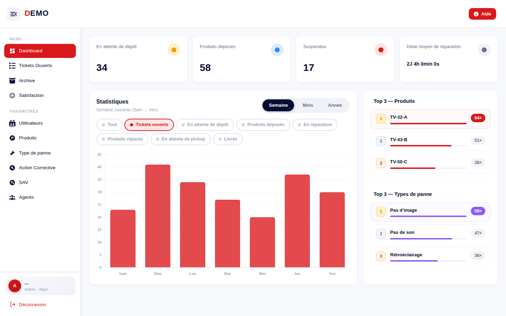

## Features

- Ticket flow: waiting, deposited, in repair, repaired, ready, delivered
- Warranty status and repair history by product
- Delay highlighting in lists
- Automatic documents and messages
- Satisfaction surveys

## Applications

| Application | Role |
| --- | --- |
| [API server](server/README.md) | Express API |
| [Management application](frontend-management/README.md) | Staff interface for administrators and service centres |
| [Customer website](frontend-customer/README.md) | Public website |

## Architecture

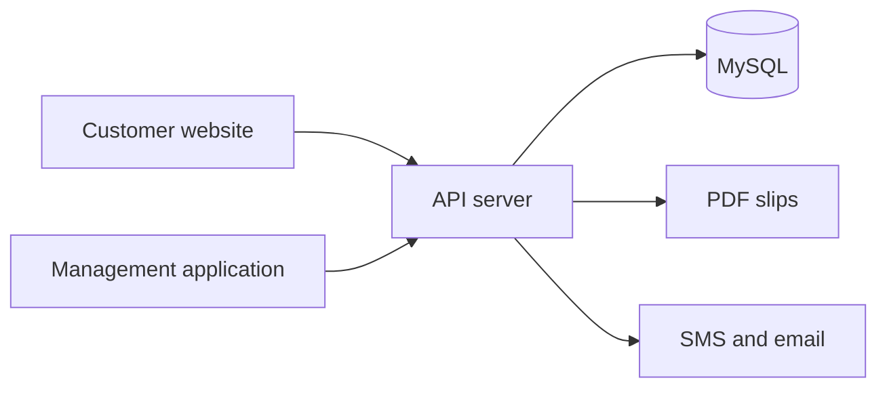

## Engineering highlights

- Paginated, searchable selectors for large reference lists
- Role-aware routing and server authorization
- Migration scripts that moved free text to relational references
- Graceful shutdown

## Screenshots

| Dashboard | Open tickets |
| --- | --- |
|  | 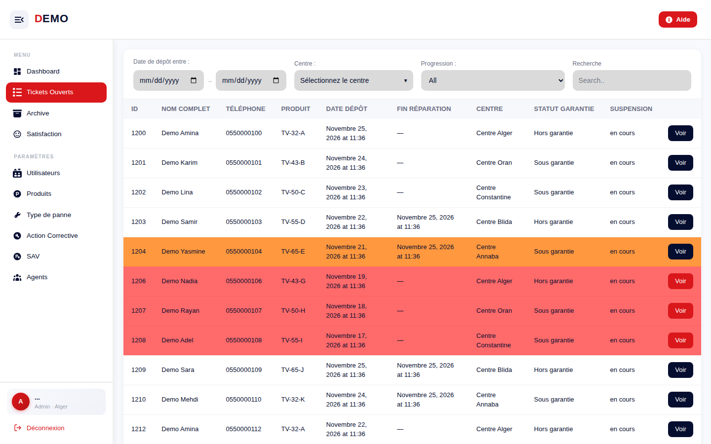 |
| **Ticket details** | **New ticket** |
| 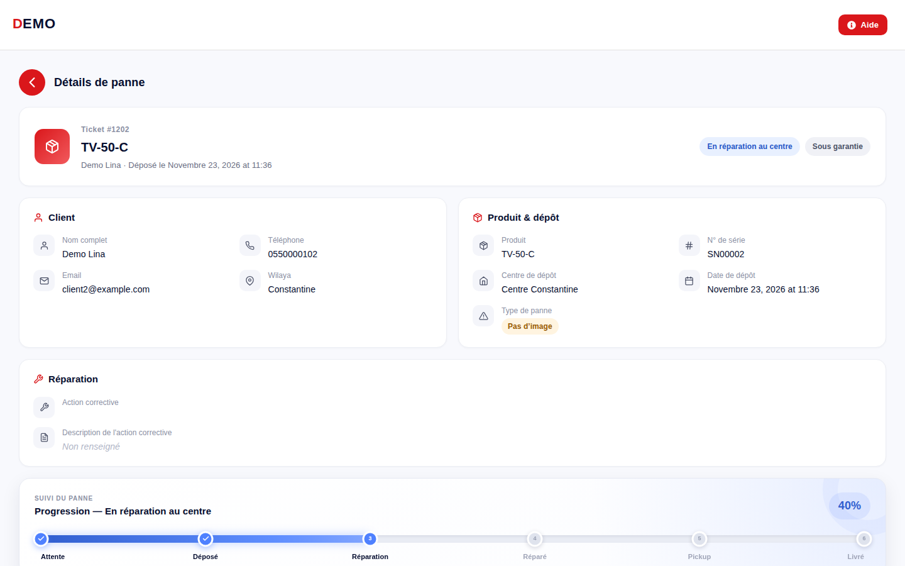 | 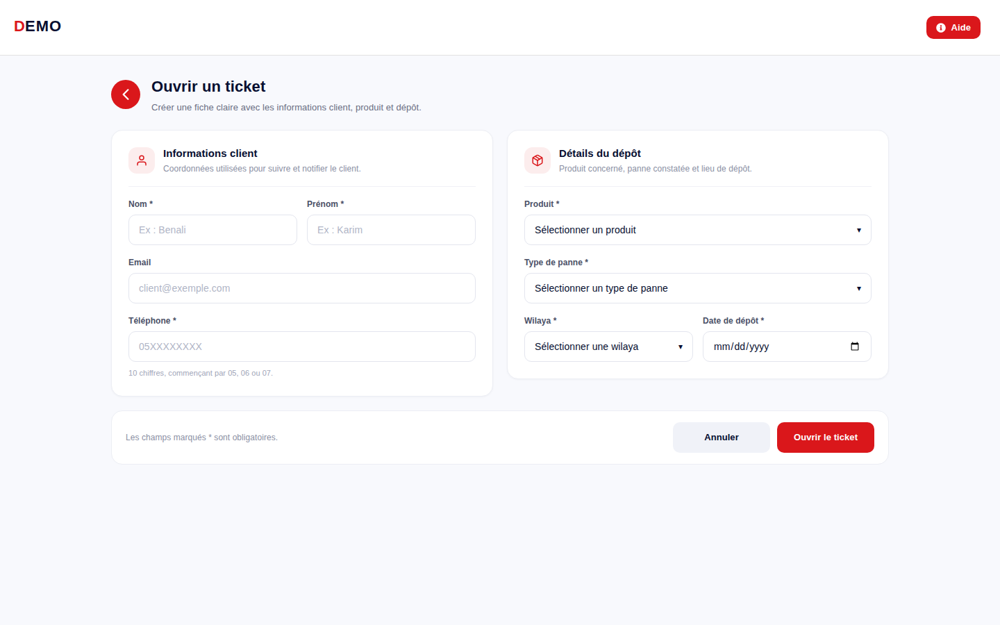 |
| **Delivered products** | **Satisfaction** |
| 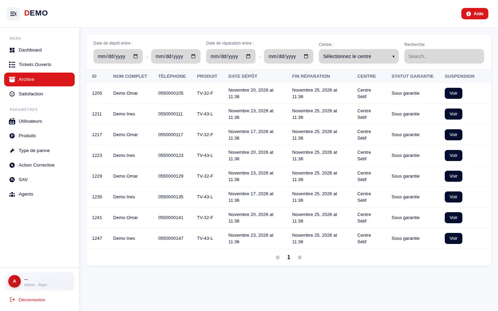 | 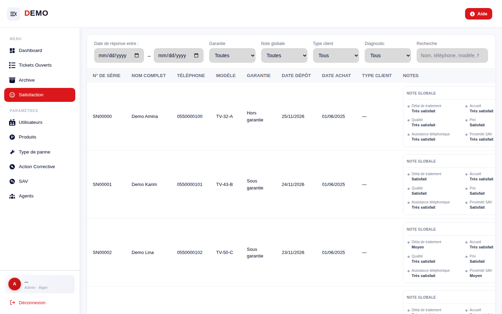 |
| **Products** | **Service centres** |
| 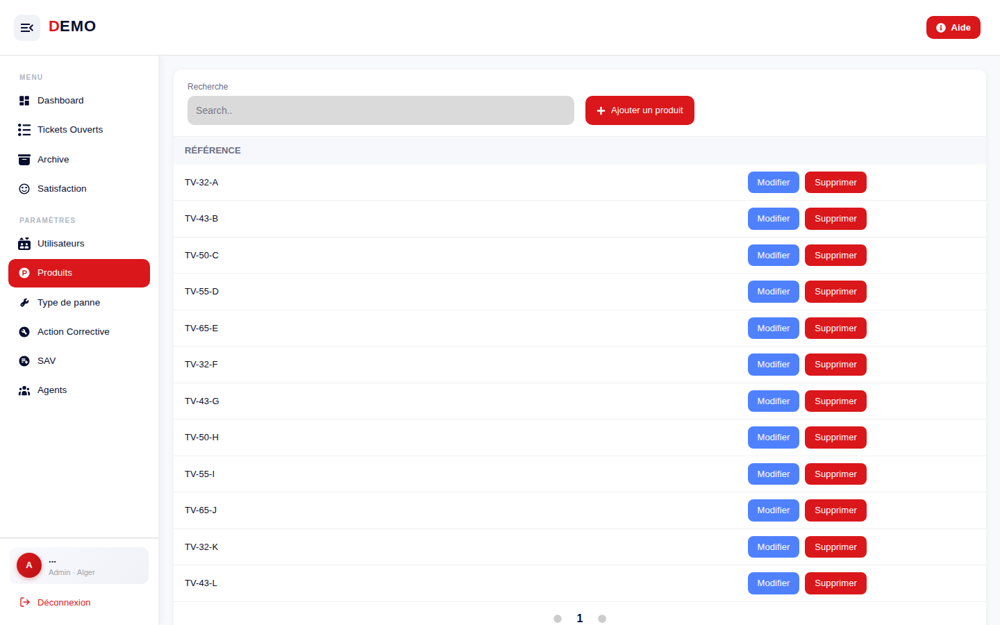 | 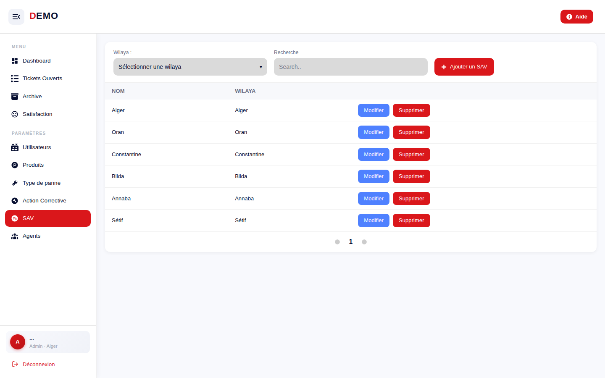 |
| **Customer website** | **Customer ticket** |
| 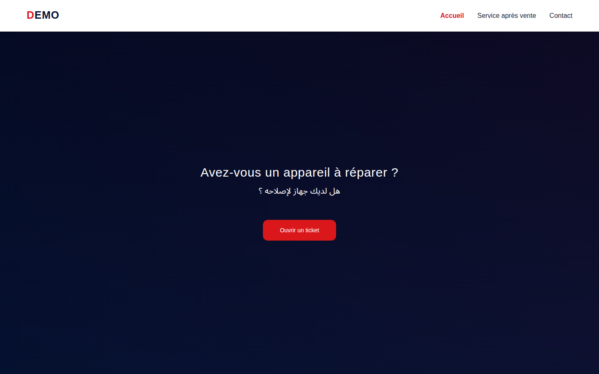 | 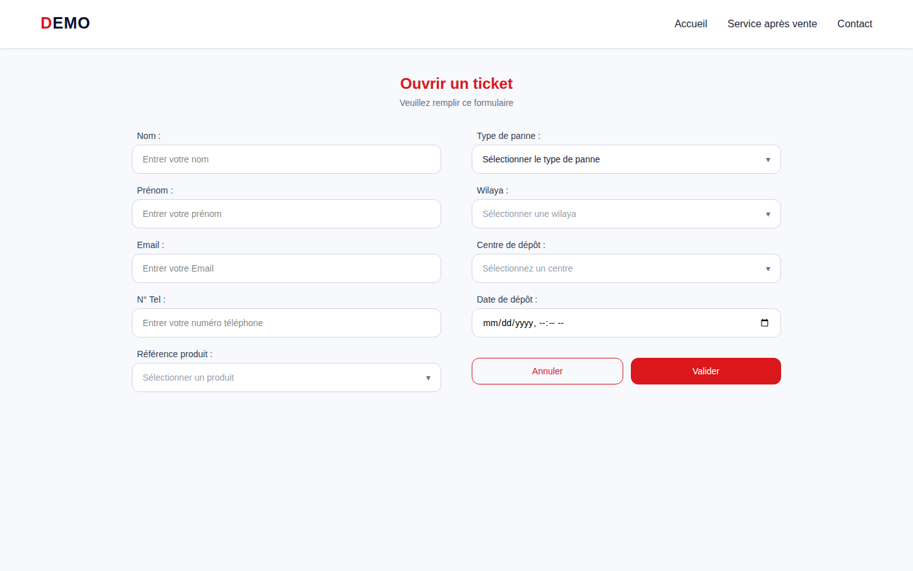 |

Screenshots show the real front ends connected to a mock API with fictional data, because the server needs MySQL. Company branding was replaced.

## Repository layout

```text
server/                                 Express API
frontend-management/                    Staff interface for administrators and service centres
frontend-customer/                      Public website
docs/screenshots/
```

Each application has its own README with responsibilities, dependencies, structure and commands.

## Usage

Published for portfolio and presentation purposes. No license is granted for reuse.
