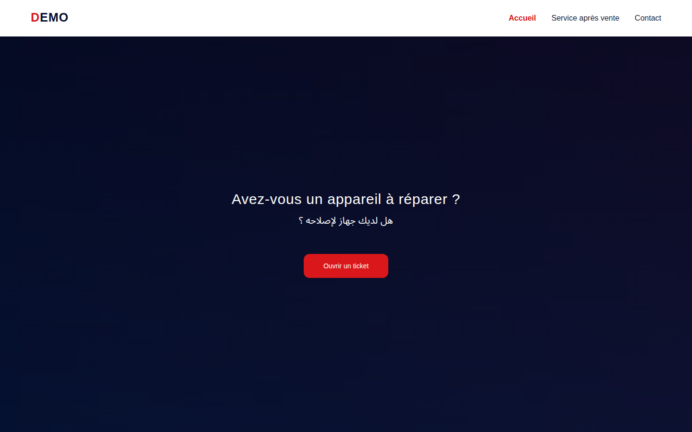
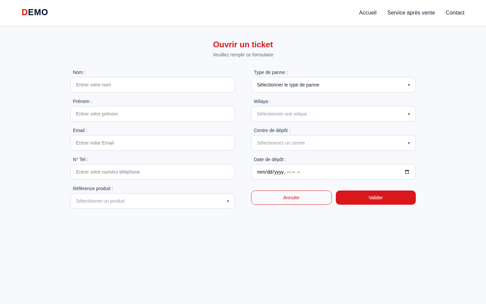

# Customer website

Public website. Part of [After-Sales Service Platform](../README.md).

> **Structure only.** The source code is private. Source files here are intentionally empty so you can see how the project is organized. Commands describe the private codebase.

## Responsibilities

- Ticket opening with product, region and centre selection
- Service centre directory
- Contact form
- PDF confirmation

## Screenshots

| Customer website | Customer ticket |
| --- | --- |
|  |  |

## Main dependencies

`@tailwindcss/vite`, `@tanstack/react-query`, `axios`, `react`, `react-dom`, `react-icons`, `react-router-dom`, `react-toastify`, `tailwindcss`

## Structure

```text
public/                           4 files
src/                              3 files
src/apis/                         1 file
src/assets/                       3 files
src/components/                   9 files
src/hooks/                        2 files
src/layouts/                      1 file
src/pages/                        5 files
src/services/                     3 files
src/utils/                        2 files
```

## Commands

```bash
npm install
npm run dev
npm run build
npm run lint
```
