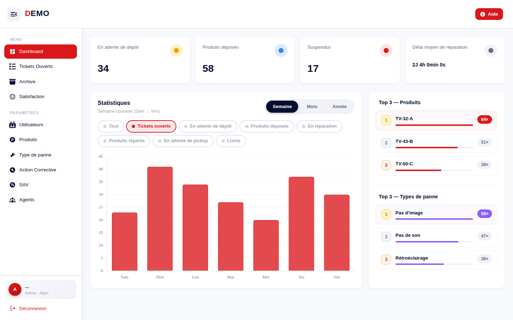
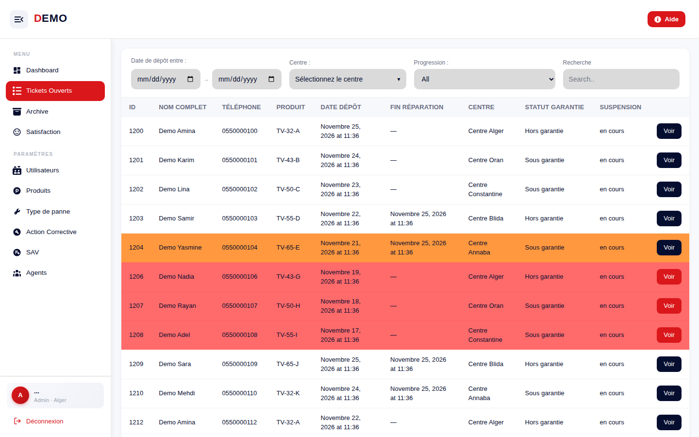
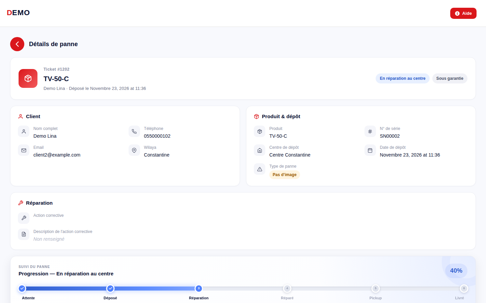
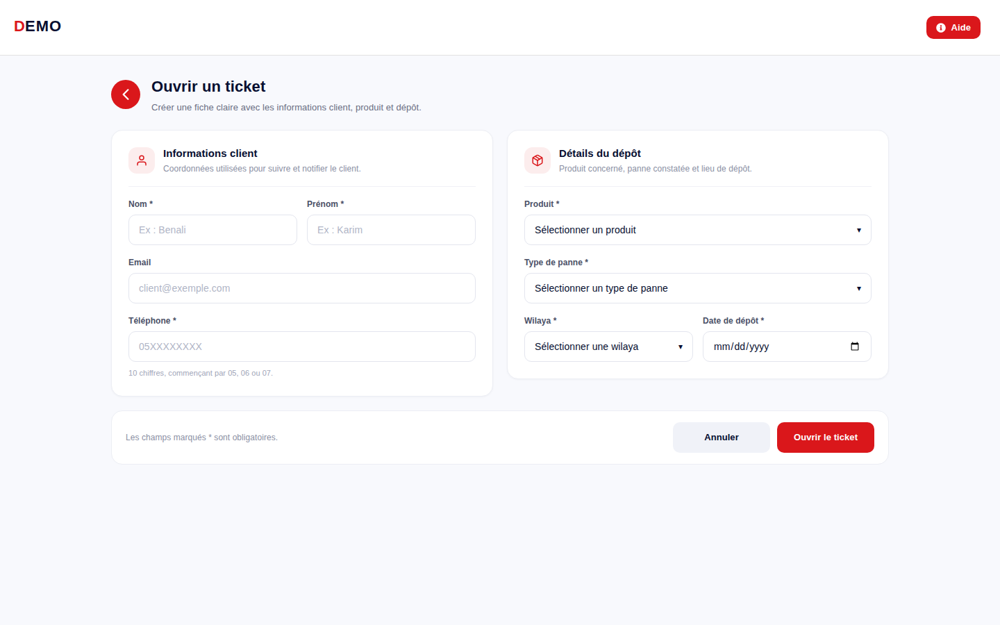
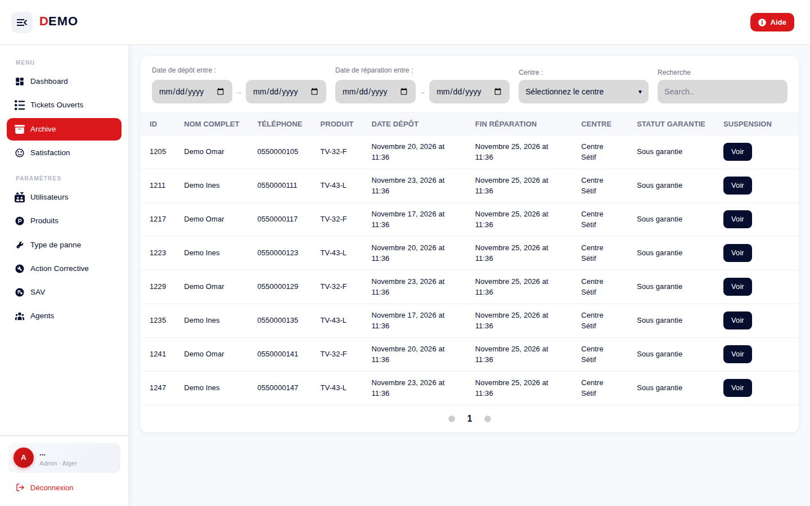
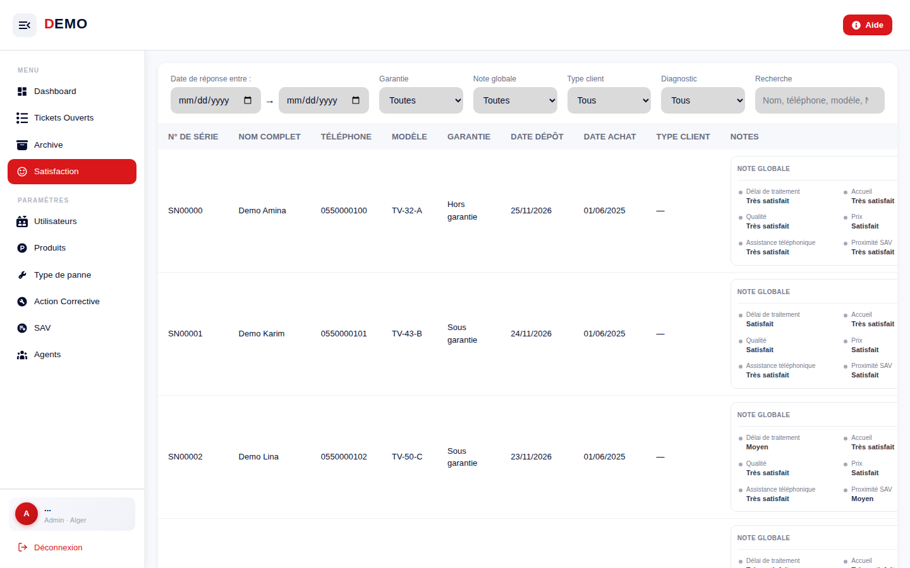
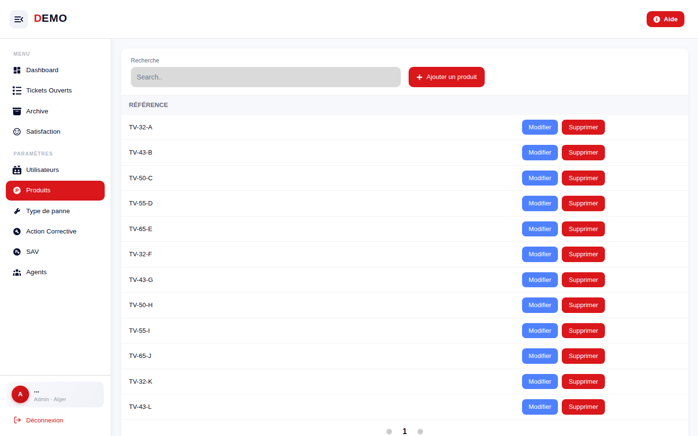
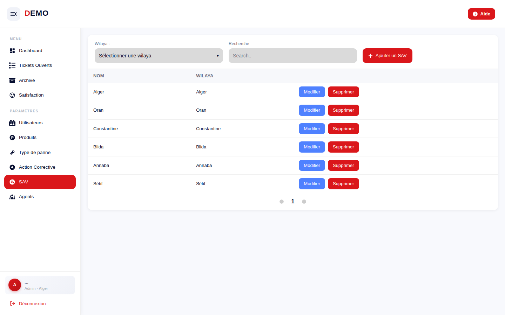

# Management application

Staff interface for administrators and service centres. Part of [After-Sales Service Platform](../README.md).

> **Structure only.** The source code is private. Source files here are intentionally empty so you can see how the project is organized. Commands describe the private codebase.

## Responsibilities

- Dashboard by week, month and year
- Tickets, repair details, suspension and closure
- Products, failure types, corrective actions
- Service centres, approved agents and users
- Customer satisfaction

## Screenshots

| Dashboard | Open tickets |
| --- | --- |
|  |  |
| **Ticket details** | **New ticket** |
|  |  |
| **Delivered products** | **Satisfaction** |
|  |  |
| **Products** | **Service centres** |
|  |  |

## Main dependencies

`@ramonak/react-progress-bar`, `@tailwindcss/vite`, `@tanstack/react-query`, `axios`, `chart.js`, `dayjs`, `jwt-decode`, `moment`, `moment-timezone`, `react`, `react-chartjs-2`, `react-dom`, `react-icons`, `react-router-dom`, `react-toastify`, `tailwindcss`, `validator`

## Structure

```text
public/                           1 file
src/                              3 files
src/api/                          5 files
src/components/                   22 files
src/context/                      1 file
src/hooks/                        5 files
src/pages/                        18 files
src/services/                     1 file
src/utils/                        5 files
```

## Commands

```bash
npm install
npm run dev
npm run build
npm run lint
```
